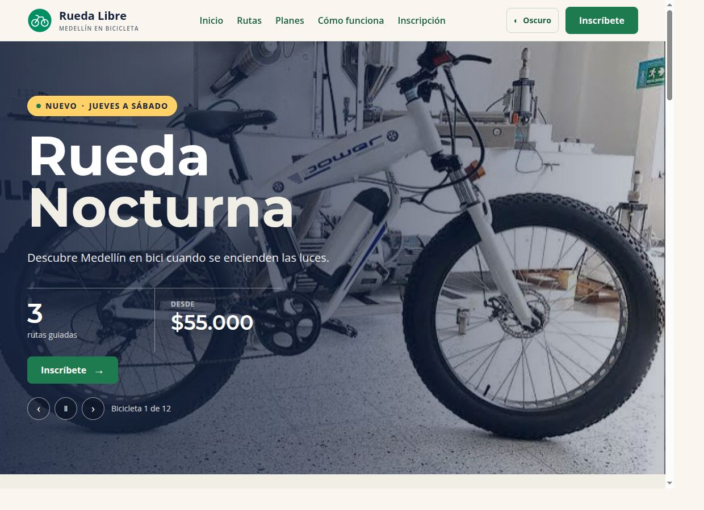
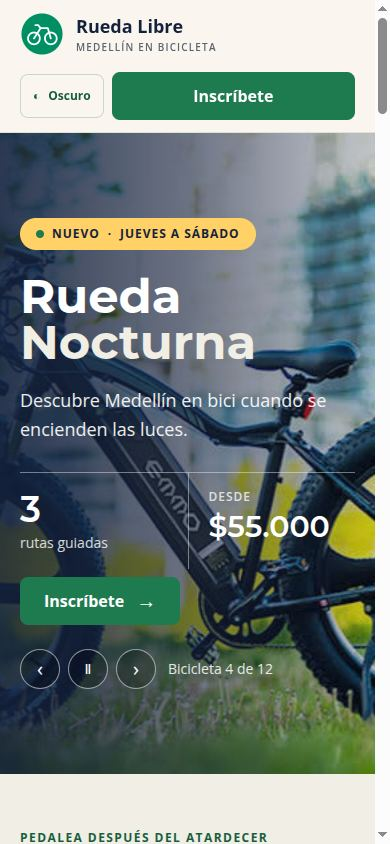
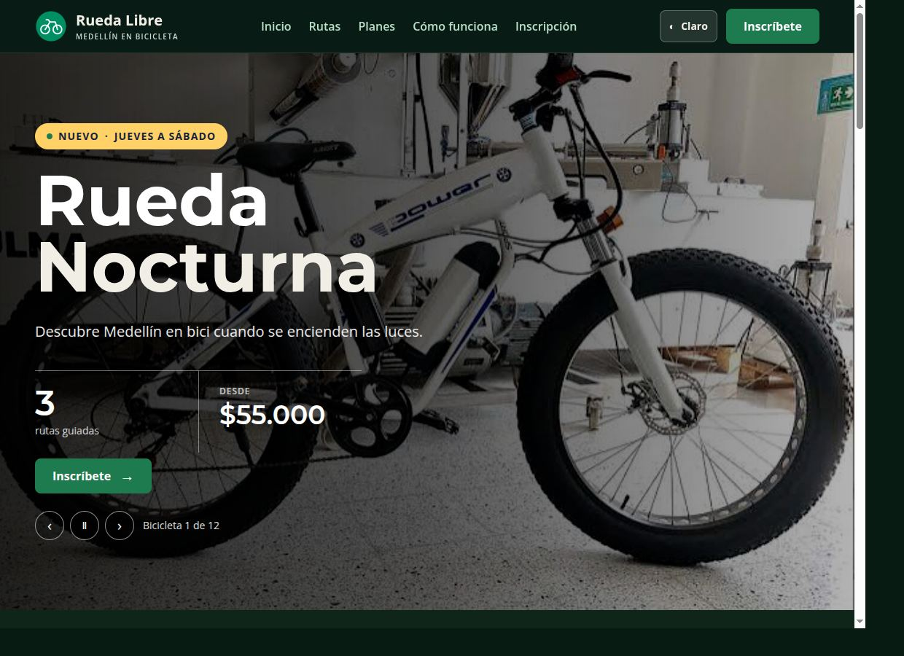

# Rueda Libre v2.0 y Rueda Nocturna

Ecosistema web para conocer los servicios de alquiler y recorridos en bicicleta de Rueda Libre en Medellín, y descubrir la campaña Rueda Nocturna con sus rutas, planes e inscripción.

## Sitio y publicación

- **Sitio Rueda Libre:** [abrir la página de inicio](./index.html).
- **Landing Rueda Nocturna:** [abrir la landing](./nocturna/index.html).
- **Sitio publicado y verificado:** [jhoimarosorio.github.io/rueda-libre](https://jhoimarosorio.github.io/rueda-libre/).
- **Landing publicada y verificada:** [Rueda Nocturna en GitHub Pages](https://jhoimarosorio.github.io/rueda-libre/nocturna/).

Las páginas se enlazan entre sí: la navegación principal y el carrusel de promociones llevan a Rueda Nocturna; el logo de la landing regresa al sitio y sus botones llevan a reservas.

## Funcionalidades

- Sitio informativo con servicios, promociones, ubicación, contacto, tarifas y reservas.
- Menú principal con acceso a Rueda Nocturna desde las páginas del sitio.
- Cuarta diapositiva del carrusel principal dedicada a la campaña nocturna.
- Landing responsive con tres rutas, planes Individual/Pareja/Grupo, instrucciones de recorrido y formulario de inscripción accesible.
- Validación nativa del formulario: campos obligatorios, nombre de al menos 3 caracteres, celular colombiano de 10 dígitos iniciado en 3 y acompañantes entre 0 y 3.
- Alternancia de tema claro/oscuro en la landing, con preferencia guardada y respeto por la configuración del sistema.
- Navegación por teclado, etiquetas asociadas a los campos, grupos semánticos y foco visible.

> **Importante:** este proyecto es una demostración estática. Los formularios validan en el navegador, pero no envían ni guardan datos; para recibir inscripciones, reservas o mensajes hace falta conectar un servidor o un servicio de formularios.

## Capturas

Las capturas de escritorio, celular y modo oscuro se encuentran en [`capturas/`](./capturas/).

| Vista | Captura |
|---|---|
| Escritorio |  |
| Celular |  |
| Modo oscuro |  |

## Tecnologías y decisión de framework

- HTML5, CSS3 y JavaScript.
- Bootstrap 5.3.8 para el sitio principal, cargado desde jsDelivr.
- Tailwind CSS 4 para la landing, compilado y minificado con Tailwind CLI.
- Montserrat para encabezados y Open Sans para texto en ambos productos, cargadas desde Google Fonts.

**Recomendación del MiniReto 8:** conservar Bootstrap en el sitio modular, donde ya se comparte entre sus páginas, y usar Tailwind para la landing independiente. Así se mantiene lo construido sin migrar el sitio completo, mientras el CSS de Tailwind se limita a las utilidades que usa la campaña. Evitaría extender ambos frameworks indiscriminadamente por las mismas páginas.

## Páginas principales

- [`index.html`](./index.html): inicio, servicios, promociones, ubicación y contacto.
- [`paginas/reservas.html`](./paginas/reservas.html): formulario de demostración para reservar bicicletas.
- [`paginas/tarifas.html`](./paginas/tarifas.html): tarifas de alquiler y recorridos.
- [`paginas/contactanos.html`](./paginas/contactanos.html): formulario de contacto.
- [`paginas/comparacion-css.html`](./paginas/comparacion-css.html): comparación entre CSS propio y Bootstrap.
- [`nocturna/index.html`](./nocturna/index.html): landing responsive de Rueda Nocturna con rutas, planes e inscripción.
- [`paginas/rueda_nocturna.html`](./paginas/rueda_nocturna.html): kit de componentes de la marca.
- [`nocturna/prototipo.html`](./nocturna/prototipo.html): prototipo inicial de la campaña.

## Organización de carpetas

- [`paginas/`](./paginas/): páginas HTML adicionales; `index.html` principal y los HTML de [`nocturna/`](./nocturna/) se mantienen en sus ubicaciones.
- [`estilos/`](./estilos/): hojas CSS, incluido el código fuente y el CSS compilado de Tailwind.
- [`JavaScript/`](./JavaScript/): scripts del sitio y los carruseles.
- [`otros/`](./otros/): manifiestos npm, bitácoras y la configuración JSON de VS Code archivada fuera de la carpeta activa `.vscode/`.
- [`img/`](./img/) y [`capturas/`](./capturas/): imágenes y evidencias visuales.

## Ejecutar y compilar

La página principal puede abrirse directamente en el navegador. Los manifiestos npm están en `otros/`; para instalar las dependencias y generar o actualizar el CSS de producción de la landing:

```bash
npm install --prefix otros
npm --prefix otros run build:nocturna
```

El comando escribe el CSS minificado en `estilos/tailwind.css`. Bootstrap y Google Fonts se cargan desde servicios externos y requieren conexión a Internet.

## Verificación para cada lanzamiento

1. Ejecuta `npm --prefix otros run build:nocturna` y confirma que `estilos/tailwind.css` actualizado quede incluido en el repositorio.
2. Prueba los formularios vacío, con datos inválidos y completos, y recórrelos con teclado.
3. Revisa las vistas de 360, 768 y 1280 px, ambos temas de la landing y los enlaces entre páginas.
4. `nocturna/index.html` y `paginas/reservas.html` se validaron con W3C Nu sin errores.
5. Verifica las dos URLs publicadas después de cada lanzamiento y confirma que no haya errores 404.

## Aprendizajes

- La semántica HTML y la validación nativa ayudan a crear formularios accesibles sin depender de una biblioteca de componentes.
- Las utilidades responsive y las variantes `dark:` de Tailwind permiten construir la landing desde móvil y mantener el tema de marca.
- Bootstrap y Tailwind responden a necesidades distintas; la decisión depende del alcance de la migración y de cómo se comparte el código.
- La integración requiere cuidar rutas relativas, navegación, identidad visual y enlaces al publicar en GitHub Pages.

## Bitácora y demo

La [bitácora del proyecto](./otros/bitacora.txt) incluye el registro de esta entrega. Los tiempos reales de las contrarrelojes y la retroalimentación de un compañero siguen pendientes de medir y registrar; no se estimaron.

Guion sugerido para una demo de hasta tres minutos:

1. Presenta el contexto de Rueda Libre y la campaña nocturna.
2. Recorre el sitio, abre Rueda Nocturna y muestra las rutas, los planes y la validación del formulario.
3. Muestra la vista móvil y el modo oscuro.
4. Explica dos decisiones: conservar Bootstrap para el sitio existente y usar Tailwind CLI para la landing; usar validación nativa en esta demostración estática, que todavía no almacena inscripciones.

## Autor

Jhoimar Osorio · [GitHub](https://github.com/JhoimarOsorio)
